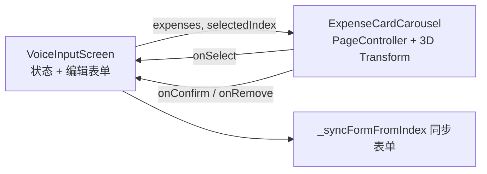

## 用户需求
语音输入页（`lib/ui/voice_input/voice_input_screen.dart`）结果态账目卡片体验重做，共三点：
1. **卡片风格精致化**：现有 160×112 简易卡片升级为毛玻璃精致卡片（分类图标圆标、大字金额、日期、备注），选中态高亮
2. **多笔账目左右滚动**：卡片支持手势左右滑动切换，滑动/点击均同步下方编辑表单
3. **3D 层叠堆叠效果**：类似安卓后台（Recents）任务卡片——中间卡片最大最亮，两侧卡片缩小、降透明度、透视旋转并向中心聚拢，滑动过程实时联动
4. **组件抽取**：卡片轮播抽取为独立文件，避免 voice_input_screen（约 1677 行）内容过多

## 产品概述
AI 解析出多笔账目后，以"3D 卡包"形式横向层叠展示：居中主卡片完整呈现一笔账目（图标、金额、日期、备注、确认/取消按钮），两侧卡片透视缩放堆叠形成景深；左右滑动翻页切换编辑目标，逐笔确认/取消后自动平滑滚动到新卡片，全部处理完保持原有回退逻辑。

## 核心功能
- 3D 层叠轮播：露边卡片透视旋转（rotateY）+ 缩放 + 透明度渐变 + 向心位移，随滑动连续变化
- 卡片内容：分类图标圆标（按分类配色）、分类名、大字金额（收入绿色区分）、日期（非今天显示）、备注行
- 每张卡片右上角确认/取消小按钮，支持逐笔操作
- 页码圆点指示器（单笔隐藏）；单笔显示单张居中卡片，统一呈现
- 卡片切换与下方编辑表单双向联动（复用 `_syncFormFromIndex`）

## 技术栈
- Flutter（Dart ^3.11.5）+ Riverpod 2.x + 现有 `AppTheme` 毛玻璃体系
- phosphor_flutter 图标；复用 `resolveCategoryIcon`/`parseHexColor`（lib/ui/shared/icon_helpers.dart，已确认存在）
- 零新增依赖，不新增 ARB 条目（复用 l10n 现有 key）

## 实现方案
1. **新建组件** `lib/ui/voice_input/widgets/expense_card_carousel.dart`
   - `ExpenseCardCarousel`（ConsumerStatefulWidget）：入参 `expenses`、`selectedIndex`、`onSelect/onConfirm/onRemove` 回调；内部私有持有 `PageController(viewportFraction: 0.78)`，dispose 释放
   - **3D 变换层**：itemBuilder 外包 `AnimatedBuilder(animation: _pageController)`，`delta = page - index` 计算 `Matrix4` 变换——透视 `setEntry(3, 2, 0.002)`、`rotateY(-delta * 0.35)`（两侧卡片朝中心旋转）、缩放 `1 - |delta|·0.15`、水平位移向中心聚拢、透明度 `1 - |delta|·0.45`；首帧 `_pageController.position.haveDimensions == false` 时用默认值防异常
   - `PageView.builder` + `clipBehavior: Clip.none` 露边堆叠；`onPageChanged` 仅 `index != selectedIndex` 时回调 `onSelect`，避免覆盖正在编辑的表单
   - `didUpdateWidget`：外部 `selectedIndex` 与控制器页码不一致时 `addPostFrameCallback + animateToPage`（目标页 clamp(0, length-1) + `hasClients` 守卫），覆盖确认/取消后的自动滚动；滑动触发的同步因页码一致自动跳过
   - `_ExpenseCard` 私有卡片：`allCategoriesProvider` 按分类名匹配 icon/color（AI 新分类回退 `dotsThree` + `#69DB7C`，与 `_saveTransaction` 自动建类一致）；`glassDecorationFull` 阴影 + glassFill/glassFillAccent；选中 accentBlue 描边高亮
2. **改造屏幕** `voice_input_screen.dart`：删除 `_buildExpenseCardList`/`_buildExpenseCard` 视觉代码（约 150 行），结果态引用轮播组件并转发回调；屏幕不再持有 PageController

## 架构设计

## 实现要点
- 列表缩短后 `animateToPage` 需 clamp + `hasClients` 双重守卫，避免移除最后一张卡越界
- 卡片数量通常 < 5，逐卡 AnimatedBuilder 重建开销可忽略；变换嵌套 Opacity 无明显性能瓶颈
- Transform 不破坏命中测试，卡片内确认/取消按钮可正常点击
- 结果态已是 SingleChildScrollView，卡片增高无溢出风险；不引入无关重构

## 验证
`flutter analyze` 0 错误 0 警告
	

## 设计风格
沿用项目深色毛玻璃（Glassmorphism）体系，重点打造"3D 层叠卡包"效果：

### 3D 堆叠轮播区
- 居中主卡片：完整亮度，accentBlue 描边 + accent 玻璃填充，毛玻璃模糊 + 投影悬浮感
- 两侧卡片：向中心透视旋转约 20°、缩小至 85%、透明度降至约 55%，水平聚拢形成层叠景深，随手指滑动连续过渡
- 卡片圆角 20，白色低透明玻璃填充，1px 玻璃描边

### 卡片内容布局
- 顶部行：分类色圆形图标底 + 分类名（加粗）+ 右侧确认/取消 24px 小圆按钮
- 中部：¥ 大字金额（收入 accentGreen，支出主文本色）
- 底部行：日期（仅非今天显示，日历小图标）+ 备注单行省略
- 未选中卡片整体弱化但不隐藏内容，保证滑动预览可读

### 指示器
- 轮播下方居中一排圆点：当前 accentBlue 实心，其余低透明度；单笔时隐藏
