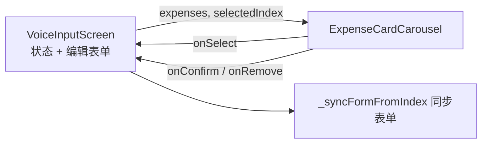

## 用户需求
- 语音输入页（voice_input_screen.dart）结果态账目卡片风格重做，更精致美观
- 多笔账目时卡片支持左右滑动浏览（轮播）
- 将账目卡片组件抽取到独立文件，避免 voice_input_screen 内容过多（现约 1677 行）

## 产品概述
语音记账确认页：AI 解析出账目后以"卡包式"毛玻璃卡片轮播展示，用户左右滑动切换各笔账目，选中卡片与下方编辑表单联动，支持逐笔确认/取消，单笔时显示单张居中卡片保持一致体验。

## 核心功能
- **精致毛玻璃卡片**：分类图标圆标（按分类配色渲染）+ 分类名、大字金额（收入绿色区分）、日期（非今天显示）、备注行
- **选中态高亮**：accentBlue 描边 + accent 填充；未选中卡片弱化缩放
- **左右滑动轮播**：多笔账目 PageView 露边轮播 + 页码圆点指示器；滑动/点击均同步下方编辑表单
- **逐笔操作**：每张卡片带确认/取消小按钮，处理完成后轮播自动平滑滚动到新的当前卡片


## 技术栈
- Flutter（Dart ^3.11.5）+ Riverpod 2.x + 现有 AppTheme 毛玻璃体系
- phosphor_flutter 图标；复用 `resolveCategoryIcon`/`parseHexColor`（lib/ui/shared/icon_helpers.dart）

## 实现方案
1. **新建组件** `lib/ui/voice_input/widgets/expense_card_carousel.dart`
   - `ExpenseCardCarousel`（ConsumerStatefulWidget）：入参 `expenses`(List&lt;ParsedExpense&gt;)、`selectedIndex`、`onSelect(index)`、`onConfirm(index)`、`onRemove(index)`
   - 内部私有 `PageController(viewportFraction: 0.85)`；`didUpdateWidget` 中外部 selectedIndex 与当前页不一致时 `addPostFrameCallback + animateToPage`（clamp + hasClients 守卫），滑动触发的同步因页码一致自动跳过；dispose 释放
   - `PageView.builder` 露边轮播，`onPageChanged` → `onSelect`；圆点指示器（仅多笔显示）
   - 私有 `_ExpenseCard`：`allCategoriesProvider` 按分类名匹配 icon/color，AI 新分类回退 `dotsThree` + `#69DB7C`（与 `_saveTransaction` 自动建类一致）；`glassDecorationFull` 阴影 + glassFill/glassFillAccent 配色
2. **改造屏幕** `voice_input_screen.dart`
   - 删除 `_buildExpenseCardList`/`_buildExpenseCard` 及相关视觉代码（约 150 行）
   - 结果态引入 `ExpenseCardCarousel`；单笔也显示卡片，统一呈现
   - 屏幕不再持有 PageController，删除/确认后仅更新 `_selectedExpenseIndex`，轮播自动跟随

## 架构设计
组件拆分为"屏幕层（状态 + 编辑表单）↔ 轮播组件（纯展示 + 回调）"，单向数据流：expenses/selectedIndex 下行，onSelect/onConfirm/onRemove 上行，符合项目 feature 目录 + 私有子组件惯例。



## 目录结构
```
lib/ui/voice_input/
├── voice_input_screen.dart          # [MODIFY] 移除旧卡片构建代码，结果态接入轮播组件
└── widgets/
    └── expense_card_carousel.dart   # [NEW] 账目卡片轮播组件（PageView + 卡片 + 指示器）
```

## 实现要点
- 列表缩短后 `animateToPage` 目标页需 clamp(0, length-1) 并以 `hasClients` 守卫，避免移除最后一张卡异常
- `onPageChanged` 仅在 `index != selectedIndex` 时回调，避免重复同步覆盖用户正在编辑的表单
- 结果态已是 SingleChildScrollView，卡片增高无溢出风险
- 复用现有 l10n key（uncategorized 等），不新增 ARB 条目；中文注释、`_CamelCase` 私有类、`package:timi/` 绝对导入
	
